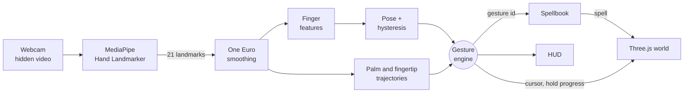
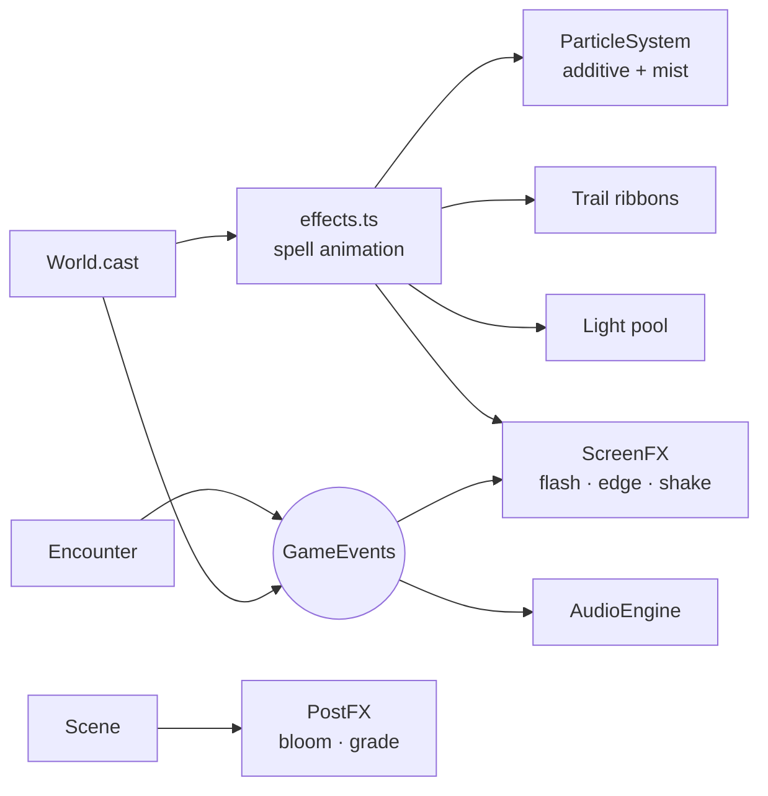

# How ARcane works

ARcane is a pipeline: camera pixels go in one end, spells come out the other. Each stage is a small module with one job, and the stages that decide what a gesture *is* know nothing about the camera or the screen.

## Stage by stage

### 1. Tracking (`src/tracking/`)
`HandTracker` opens the camera and feeds frames directly to MediaPipe's Hand Landmarker (GPU first, CPU as fallback). The original direct-inference path is the default. A worker implementation remains experimental and is enabled only with `?tracking=worker`; it keeps at most one camera frame in flight. Neither path turns valid detections into missing hands solely because inference exceeds a fixed age cutoff. The selectable camera cap is 30 or 60 FPS, while debug stats distinguish requested/actual camera FPS, completed inference FPS, inference duration and result age. The captured frame timestamp is carried unchanged into gesture processing. It converts the 21 landmarks into one consistent **tracking space**: x mirrored so the world behaves like a mirror, y downward, x and z scaled by the video aspect ratio so all axes share a unit. The video element is invisible and never drawn; only landmark numbers leave the class.

### 2. Smoothing (`LandmarkSmoother`, `OneEuroFilter`)
Raw landmarks jitter by a few pixels. A **One Euro filter** runs on every coordinate: its cutoff frequency rises with speed, so a still hand is smoothed heavily and a fast hand is barely delayed. Two parameters control it: `minCutoff` (steadiness at rest) and `beta` (responsiveness in motion).

### 3. Features (`src/gestures/features.ts`)
For each finger, an **extension score** from 0 (curled) to 1 (straight) measures the bend at its two finger joints and at its knuckle. Straight fingers held roughly perpendicular to the palm remain extended; the knuckle check only penalizes fingers folded back toward the palm. This avoids treating a horizontal open hand or naturally short straight finger as curled, or a flexed finger as extended just because its tip is still far from its base. These 3D angle features are invariant to uniform scaling and rigid rotation; camera occlusion and inaccurate depth estimates can still affect them. Collapsed joints mark a frame as unknown, and a fist requires clearly curled scores rather than merely the absence of extended fingers.

### 4. Poses (`poses.ts`)
Scores become booleans with **hysteresis**: by default a finger turns "extended" at 0.68 and "curled" at or below 0.52, so a borderline finger does not flicker. The four booleans (index, middle, ring, pinky) form a pattern that maps to a named pose. Held signs use smoothed landmarks; movement gestures use current-frame features with a separate hysteresis tracker and multi-sample validation, so visual smoothing does not label a quick stroke with the previous hand shape. The thumb is deliberately ignored: none of the shipped poses need it.

### 5. Motions (`motion.ts`)
The engine records the palm centre and the index fingertip over the last ~1.7 seconds, in **hand units** (multiples of palm length) so that movements are the same size to the detector whether you sit near or far.

- **Swipes**: looks for a recent segment ending at the newest sample that is long enough, fast enough, straight enough and aligned with the required direction, with the requested hand shape present for most of the segment. Open-hand and fist strokes follow the raw palm centre; pointing strikes (Skybolt, Impale and Wyrm Slash) follow the raw index fingertip. Displacement is divided by palm size, rather than subtracting absolute positions normalized by different sizes. Stopped strokes and single-sample tracking jumps are rejected. A new shape can use one preceding frame as an onset anchor only after at least three consecutive samples confirm it.
- **Circles**: while pointing, fits a circle to the fingertip path and checks radius, roundness (radial variance), swept angle (≥ 300°) and that the rotation went mostly one way, which rejects scribbles.

### 6. The engine (`GestureEngine.ts`)
Ties it together and adds the human factors:

- **Hold-to-cast** for shapes, with progress reported for the HUD.
- **Stillness for overlapping holds**: a matching held sign cannot charge through its assigned movement gesture. Pointing holds also watch fingertip movement, so Lance does not consume a developing Skybolt stroke. A stationary hold still casts normally; movement during its cooldown remains blocked.
- **Latching**: a held pose casts once, and re-arms only when you change to another shape.
- **Cooldown** after every cast, and buffers cleared so the return stroke of a swish does not cast again.
- **Dropout bridging**: a lost hand is tolerated for 180 ms before state resets. State also expires when a delayed camera result arrives after a longer stall, even if no null frames were delivered in between.
- **Cursor**: the palm position mapped to 0..1 screen coordinates, with adjustable reach. Large one-frame aim jumps are held at the last anchor until consecutive raw samples confirm the relocation; this check is separate from the raw motion trails, so it does not slow fast gesture recognition.

`GestureEngine` takes a `HandFrame | null` plus the timestamp of the captured video frame and returns an `EngineOutput`. It has no dependency on the DOM, camera or Three.js, which is why the whole thing is unit-tested with synthetic hands and replayed at different capture rates. Swipe, circle and two-hand motion thresholds are expressed in elapsed time and palm-relative travel rather than assuming a fixed number of samples.

### 6b. Two hands (`HandBinder.ts`, `HandsEngine.ts`, `dual.ts`)
MediaPipe returns up to two hands in an arbitrary order. `HandBinder` pins them to stable left and right slots by following each wrist from frame to frame; near-identical overlapping palm detections are collapsed, and a newly appearing second track is confirmed on consecutive frames before becoming live. The first pairing follows the on-screen layout, and the model’s Left/Right label is only a hint for a lone hand. `HandsEngine` runs one `GestureEngine` per slot, so each hand is smoothed and classified independently and can cast on its own; a slot bridged internally through a brief dropout is not exposed as a currently live hand. On top of that it watches both palms together for two-hand signs and motions (`dual.ts`), ordering the palms by screen position so those motions never depend on which slot a hand landed in. A two-hand sign claims its shape from the single-hand gestures while both hands show it.

Slot memory expires per hand, not per result array. An established hand that returns within the dropout grace period keeps its slot immediately; only genuinely new tracks need confirmation. A palm-size-relative continuity radius prevents short, fast solo-hand strokes from switching engines when handedness flickers. Numeric-invalid landmark arrays are rejected before smoothing.

The engine only listens for gestures that are bound to a spell (`SpellBook.activeGestures()`), so unassigned gestures cannot fire or consume the cooldown.

#### Bow Draw (`BowRecognizer.ts`)
The bow arms when one hand points and the other pinches (thumb–index gap in palm lengths, measured in 3D or as a tight on-screen overlap, with hysteresis). The draw is the pinching hand's pull away from the pointer, measured on screen *and* in depth: a hand receding from the lens shrinks, so `(s₀/s − 1) × 5.5` palm lengths of pull is added, relative to the aiming hand so leaning back does not count. A draw survives hand drop-outs up to 240 ms and `unknown`/`fist` misreads of a foreshortened pointing finger; only a clearly different aim shape held for 260 ms abandons it. The shot uses the peak draw from the last 200 ms. While engaged, `HandsEngine` calls `GestureEngine.suspend()` (clear trails, restart holds, **no** cast pause); only a fired arrow starts the cast pause. Before the pinch closes, *bow intent* (one hand pointing, the other's thumb approaching its index) suppresses the aiming hand's pointing strikes and sigils and the nocking hand's holds through `ProcessContext`.

#### Cross-gesture arbitration
- **Strike confirmation:** while a sigil is live, a pointing strike is held for 150 ms and cancelled if the smoothed fingertip path keeps turning more than 30° (arc-length resampled, cusps ignored). A path that already turned more than 150° in the last 650 ms is a sigil in progress and cannot strike.
- **Direction dominance:** single-direction sweeps need their main axis at least 1.15× the other.
- **Blur tolerance:** `unknown` frames are a quarter vote in stroke shape checks; sigils allow up to 15% `unknown` frames, never more than two in a row.
- **Confidence-weighted holds:** charge rate 0.85–1.2× based on how far every finger sits from its hysteresis edge; capped at 1× when the shape also starts a live motion.

### 7. Spells (`src/spells/`, `src/config/`)
The engine reports **gesture ids** such as `"fist"`. The `SpellBook` maps gestures to spells (one gesture, one spell, always) and persists the player's choices. Gestures and spells are declared as data in `src/config/gestures.ts` and `spells.ts`.

### 8. World and UI (`src/world/`, `src/ui/`)
`World` renders a Three.js scene, turns the cursor into a wisp in 3D space, and paints a particle effect plus a floating label for each spell. The world renders at the display's frame rate, independent of the camera's, and eases the wisp toward the latest cursor so motion stays fluid even at 30 camera frames per second. The HUD, Spellbook panel and debug overlay are small DOM modules.

### 9. Presentation pipeline (`src/world/`, `src/audio/`, `src/ui/ScreenFX.ts`)

- **`particles.ts`** pools GPU particles (glow, spark and mist styles) with world-unit sizes, swap-remove compaction and one draw call per pool (additive and normal-blended mist).
- **`vfx.ts`** holds camera-facing `Trail` ribbons, shared cached glow/ring/flare textures (never disposed per effect), easing helpers and the `FxContext` an effect may draw into.
- **`effects.ts`** builds each spell. Lightning bolts are camera-plane ribbons with width proportional to target depth (constant on-screen thickness) and fractal displacement proportional to segment length (scale-invariant shape). Effects never add lights; they borrow from a fixed pool of three in `World`, so no cast recompiles a lit shader.
- **`events.ts`** is a typed `GameEvents` bus (casts, impacts, wind-ups, strikes, hits, deaths, projectiles, player damage, encounter state). Presentation listens; gameplay never depends on a listener.
- **`PostFX.ts`** renders bloom at half resolution, then a display-space grade (highlight shoulder, split tone, vignette, grain). The renderer itself does no tone mapping because the illustrated scene is authored untonemapped. Post is switched off automatically when the frame budget bottoms out, or with `?post=0`.
- **Camera shake** is trauma-based and applied only for the draw call, then the camera is restored, so aiming and targeting always use the steady view.
- **`AudioEngine.ts`** synthesises everything with WebAudio (oscillators, filtered noise, a generated reverb impulse and a compressor) and unlocks on the first user gesture.
- **`Creature.ts`** builds each spirit as a painted 2D bone rig: every painting (head, robe, arms, legs, the Hollow's cape and moss) is one soft-edged sheet skinned to a shared skeleton (hips → spine → chest → neck → head, shoulder → elbow → wrist → talons, thigh → knee → ankle), so limbs bend the paint itself instead of swinging cut pieces. Joints are driven through damped springs, so motion arrives late, overshoots slightly and settles. A `life` value runs everything down during the spirit's holds (it stops and simply watches) and during the frozen beat at the top of a wind-up. The shared material is blended (soft edges), ripples cloth in the vertex shader (`uFlow`), and in the fragment applies the dissolve, spell light, distance haze and the ground mist that swallows the feet. `Encounter` sets each spirit's `group.renderOrder` far-to-near every frame so blended figures sort as units; internal nodes are plain `Object3D`s and `Bone`s because a nested `THREE.Group` would reset that order. Eyes, mouth, palm power and strike smear remain overlay meshes flagged `userData.arcaneOverlay`.
- **`CreatureArtwork.ts` / `paint.ts`** paint the sheets as quiet masses with soft interior detail (`softLayer`), then `finish()` feathers the silhouette, darkens toward it, lays a backlight on edges facing the sky, adds grain and colour bleed, and fades limbs into the body or the hem into mist. Textures are shared between spirits of a kind.
- **`GnomeSummons.ts`** renders each `<g id>` of `public/assets/summons/gnome-*.svg` into its own cropped texture and hangs the 15 parts on a joint tree (`PARTS`). A base pose (breathing, run cycle, the climb out of the ground) is overridden by the keyframed throw (`THROW`): stoop, grab, carry, cock, hurl, follow through. Rocks are baked-light faceted stones on a ballistic arc that shatter on spirits, scenery or the ground.
- **`Atmosphere.ts`** adds terrain-following ground mist, drifting fog wisps, moonlight shafts and the shader-timed watchers. `VolumetricFog.ts` draws the domain-warped fog banks.

## Design decisions

- **Gestures are data.** Adding one is an entry in a list, not a code change in the engine (unless it needs a new kind of recogniser).
- **Gestures and spells are separate.** The engine reports what you did; the Spellbook decides what it means. That is what makes rebinding trivial.
- **Everything numeric is testable.** `tests/helpers/synth.ts` builds an anatomically plausible hand and replays it frame by frame.
- **Local first.** The MediaPipe runtime and model are copied into `public/` by `npm run setup:assets`, with a CDN fallback, so the game works offline.

## Performance

Tracking runs at the camera's frame rate (a 640×480 stream keeps it light). Particles are two draw calls regardless of count. Bloom runs at half resolution. The adaptive `FrameBudget` lowers the pixel ratio first and drops post-processing only if frames are still slow at the floor. Fog and mist shaders reject invisible fragments before evaluating noise. The per-frame gesture analysis touches a few dozen numbers and allocates little.
