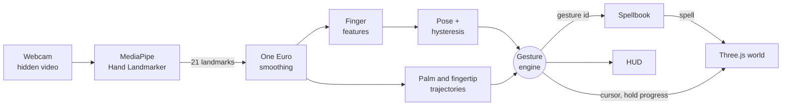

# How ARcane works

ARcane is a pipeline: camera pixels go in one end, spells come out the other. Each stage is a small module with one job, and the stages that decide what a gesture *is* know nothing about the camera or the screen.

## Stage by stage

### 1. Tracking (`src/tracking/`)
`HandTracker` opens the camera and feeds frames to MediaPipe's Hand Landmarker (GPU first, CPU as fallback). It converts the 21 landmarks into one consistent **tracking space**: x mirrored so the world behaves like a mirror, y downward, x and z scaled by the video aspect ratio so all axes share a unit. The video element is invisible and never drawn; only landmark numbers leave the class.

### 2. Smoothing (`LandmarkSmoother`, `OneEuroFilter`)
Raw landmarks jitter by a few pixels. A **One Euro filter** runs on every coordinate: its cutoff frequency rises with speed, so a still hand is smoothed heavily and a fast hand is barely delayed. Two parameters control it: `minCutoff` (steadiness at rest) and `beta` (responsiveness in motion).

### 3. Features (`src/gestures/features.ts`)
For each finger, an **extension score** from 0 (curled) to 1 (straight) measures the bend at its two finger joints and at its knuckle. Straight fingers held roughly perpendicular to the palm remain extended; the knuckle check only penalizes fingers folded back toward the palm. This avoids treating a horizontal open hand or naturally short straight finger as curled, or a flexed finger as extended just because its tip is still far from its base. These 3D angle features are invariant to uniform scaling and rigid rotation; camera occlusion and inaccurate depth estimates can still affect them. Collapsed joints mark a frame as unknown, and a fist requires clearly curled scores rather than merely the absence of extended fingers.

### 4. Poses (`poses.ts`)
Scores become booleans with **hysteresis**: by default a finger turns "extended" at 0.68 and "curled" at or below 0.52, so a borderline finger does not flicker. The four booleans (index, middle, ring, pinky) form a pattern that maps to a named pose. Held signs use smoothed landmarks; movement gestures use current-frame features with a separate hysteresis tracker and multi-sample validation, so visual smoothing does not label a quick stroke with the previous hand shape. The thumb is deliberately ignored: none of the shipped poses need it.

### 5. Motions (`motion.ts`)
The engine records the palm centre and the index fingertip over the last ~1.7 seconds, in **hand units** (multiples of palm length) so that movements are the same size to the detector whether you sit near or far.

- **Swipes**: looks for a recent segment ending at the newest sample that is long enough, fast enough, straight enough and aligned with the required direction, with the requested hand shape present for most of the segment. Open-hand and fist strokes follow the raw palm centre; pointing strikes (Skybolt, Impale and Wyrm Slash) follow the raw index fingertip. Displacement is divided by palm size, rather than subtracting absolute positions normalized by different sizes. Stopped strokes and single-sample tracking jumps are rejected. A new shape can use one preceding frame as an onset anchor only after at least three consecutive samples confirm it.
- **Circles**: while pointing, fits a circle to the fingertip path and checks radius, roundness (radial variance), swept angle (≥ 300°) and that the rotation went mostly one way, which rejects scribbles.

### 6. The engine (`GestureEngine.ts`)
Ties it together and adds the human factors:

- **Hold-to-cast** for shapes, with progress reported for the HUD.
- **Stillness for overlapping holds**: a matching held sign cannot charge through its assigned movement gesture. Pointing holds also watch fingertip movement, so Lance does not consume a developing Skybolt stroke. A stationary hold still casts normally; movement during its cooldown remains blocked.
- **Latching**: a held pose casts once, and re-arms only when you change to another shape.
- **Cooldown** after every cast, and buffers cleared so the return stroke of a swish does not cast again.
- **Dropout bridging**: a lost hand is tolerated for 180 ms before state resets.
- **Cursor**: the palm position mapped to 0..1 screen coordinates, with adjustable reach.

`GestureEngine` takes a `HandFrame | null` plus a timestamp and returns an `EngineOutput`. It has no dependency on the DOM, camera or Three.js, which is why the whole thing is unit-tested with synthetic hands.

### 6b. Two hands (`HandBinder.ts`, `HandsEngine.ts`, `dual.ts`)
MediaPipe returns up to two hands in an arbitrary order. `HandBinder` pins them to stable left and right slots by following each wrist from frame to frame; the first pairing follows the on-screen layout, and the model’s Left/Right label is only a hint for a lone hand. `HandsEngine` runs one `GestureEngine` per slot, so each hand is smoothed and classified independently and can cast on its own. On top of that it watches both palms together for two-hand signs and motions (`dual.ts`), ordering the palms by screen position so those motions never depend on which slot a hand landed in. A two-hand sign claims its shape from the single-hand gestures while both hands show it.

The engine only listens for gestures that are bound to a spell (`SpellBook.activeGestures()`), so unassigned gestures cannot fire or consume the cooldown.

### 7. Spells (`src/spells/`, `src/config/`)
The engine reports **gesture ids** such as `"fist"`. The `SpellBook` maps gestures to spells (one gesture, one spell, always) and persists the player's choices. Gestures and spells are declared as data in `src/config/gestures.ts` and `spells.ts`.

### 8. World and UI (`src/world/`, `src/ui/`)
`World` renders a Three.js scene, turns the cursor into a wisp in 3D space, and paints a particle effect plus a floating label for each spell. It renders at the display's frame rate, independent of the camera's, and eases the wisp toward the latest cursor so motion stays fluid even at 30 camera frames per second. The HUD, Spellbook panel and debug overlay are small DOM modules.

## Design decisions

- **Gestures are data.** Adding one is an entry in a list, not a code change in the engine (unless it needs a new kind of recogniser).
- **Gestures and spells are separate.** The engine reports what you did; the Spellbook decides what it means. That is what makes rebinding trivial.
- **Everything numeric is testable.** `tests/helpers/synth.ts` builds an anatomically plausible hand and replays it frame by frame.
- **Local first.** The MediaPipe runtime and model are copied into `public/` by `npm run setup:assets`, with a CDN fallback, so the game works offline.

## Performance

Tracking runs at the camera's frame rate (a 640×480 stream keeps it light). The world is a single draw call for particles plus a handful of meshes. Pixel ratio is capped at 2. The per-frame gesture analysis touches a few dozen numbers and allocates little.
